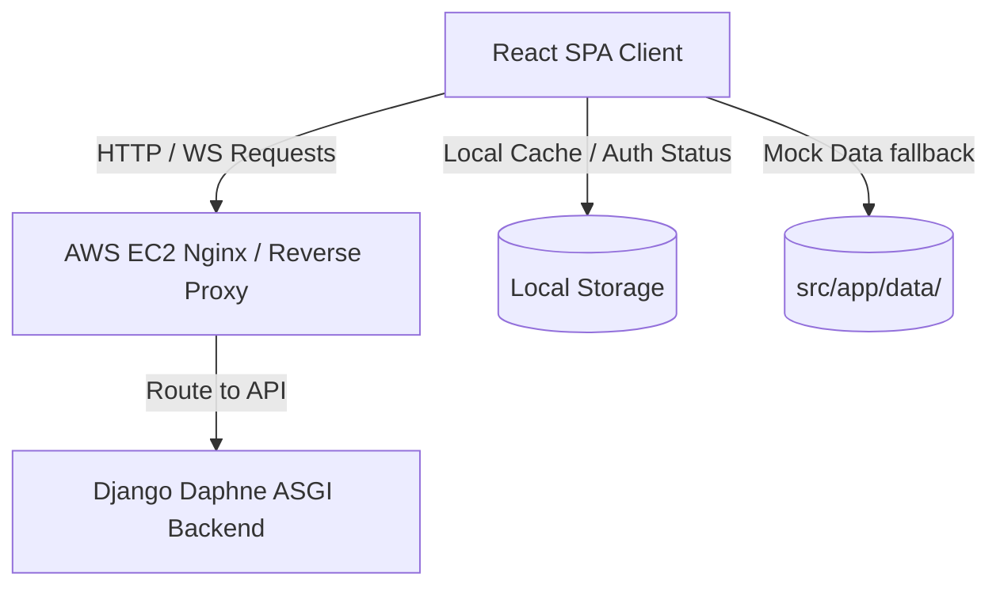

# Frontend Project Context & Architecture

This document provides a detailed overview of the **Matchmaking CRM Dashboard** frontend architecture, style sheets, layout conventions, and how it communicates with the AWS-deployed backend APIs.

---

## 1. System Architecture Overview

The Matchmaking CRM Dashboard is a React-based Single Page Application (SPA) designed as an administrative dashboard to manage user matching, leads pipelines, chat communications, subscription billing, and reporting metrics.

### Hosting & Deployment Details
- **Frontend Hosting**: The compiled static SPA bundle is planned for deployment on an **AWS S3 Bucket** configured for static web hosting. It will be mapped to the custom production domain: **`admin.amuslimmatchmaker.com`** (currently pending final deployment).
- **Backend API Server**: Deployed on an **AWS EC2** instance, handling API and WebSocket requests forwarded by an Nginx reverse proxy. The API runs on the custom production domain: **`api.amuslimmatchmaker.com`**.
- **Cross-Origin Resource Sharing (CORS)**: The AWS EC2 backend allows requests originating from the production dashboard domain (`admin.amuslimmatchmaker.com`).

---

## 2. Frontend Tech Stack & Core Libraries

- **Framework**: React 18.3.1 (using TypeScript for strict typing).
- **Build & Asset Bundler**: Vite 6.3.5, configured with a custom asset resolver to import Figma graphics dynamically (`figma:asset/`).
- **Routing**: React Router v7 (`react-router`), utilizing `createBrowserRouter` and `<RouterProvider>`.
- **Styling & Theme**:
  - **Tailwind CSS v4**: Integrates via `@tailwindcss/vite` and the direct CSS `@import 'tailwindcss'` directive.
  - **MUI (Material UI v7)**: Used for select interactive inputs and core dashboard layouts.
  - **tw-animate-css**: Provides clean UI transitions and card animations.
- **Key Client Libraries**:
  - `recharts` for charts and analytics reporting.
  - `lucide-react` for dashboard icons.
  - `motion` (Framer Motion v12) for dashboard page transits.
  - `sonner` for toast notifications.
  - `ckeditor5` & `@ckeditor/ckeditor5-react` for email/message template composition.

---

## 3. Directory Structure & Key Files

### Root Workspace Files
- `package.json`: Main script definitions (`npm run dev`, `npm run build`) and dependencies.
- `vite.config.ts`: Configuration enabling React plugin, Tailwind CSS v4 compiler, alias mapping (`@` to `/src`), and Figma asset imports.
- `default_shadcn_theme.css`: Declares custom colors and layout boundaries for theme synchronization.

### Source Directory (`/src`)
- `main.tsx`: Entry point loading the React tree and styling layers.
- `styles/`: Styling layer.
  - `index.css`: Chains imports of `fonts.css`, `tailwind.css`, and `theme.css`.
  - `tailwind.css`: Imports core Tailwind v4 directives and links sources `@source '../**/*.{js,ts,jsx,tsx}';`.
  - `theme.css`: Declares base variable parameters for colors (`--primary`, `--secondary`, `--accent`, `--border`), typography classes under `@layer base`, and animations.
- `app/`:
  - `App.tsx`: Renders the `<RouterProvider>` with our application router.
  - `routes.tsx`: Defines standard browser routes (e.g., `/login`, dashboard home `/`, `/users`, `/matchmaking`, `/leads`, `/chat`, `/subscriptions`, `/reports`, `/settings`).

### Components (`/src/app/components`)
- `RootLayout.tsx`: Implements the outer dashboard wireframe, containing the sidebar navigation menu, header with profiles, search box, and page routing outlets.
- `Login.tsx`: Authenticates administrators. Implements credentials verification with an animated slide transition into an OTP (One-Time Password) code input check.
- `Dashboard.tsx`: Main overview hub. Summarizes statistics using Recharts Line Charts, status cards, and recent CRM logs.
- `Users.tsx` & `UserDetail.tsx`: Main user profile database. Implements extensive query filtration (marital status, religion, age range, location) and view details screen.
- `Matchmaking.tsx`: Dynamic dashboard workflow enabling matchmakers to search compatibility profiles and dispatch matching requests.
- `Matches.tsx`: Central hub for reviewing established matches, controlling reveal controls (e.g. photo reveals), and monitoring status.
- `Requests.tsx`: Connection and matchmaking requests coordinator.
- `Leads.tsx` & `LeadsList.tsx`: CRM pipeline visualizer. Maps leads sequentially through pipeline stages.
- `Chat.tsx`: Real-time chat interface.
- `CustomFields.tsx` & `Settings.tsx`: Control panels for customization fields and application parameters.
- `Reports.tsx`: Extended analytical reports and user metrics.
- `Subscriptions.tsx`: Coordinates pricing structures and subscriber limits.

### Mock Data (`/src/app/data`)
To support standalone frontend compilation and offline test environments, mock datasets mimic the Django API responses:
- `mockUsers.ts`: Array of fully formed user profiles (including preferences, pictures, and statuses).
- `mockLeads.ts`: Client pipeline stage leads.
- `mockMatchmakers.ts`: List of administrative matchmakers.
- `filterChoices.ts`: Static arrays representing dropdown values (Nationalities, Ethnicties, Marital Statuses, etc.) to maintain consistency across the app.

---

## 4. Frontend Integration Patterns

### Authentication & Sessions
Local storage maintains simple auth tokens:
- Verification status is initialized and checked against `amm_auth` (`localStorage.getItem("amm_auth") === "true"`).
- Root routing protects views by redirecting non-authenticated sessions back to `/login`.

### API & WebSockets Hook-ups
The application is pre-styled to be connected to:
- **REST Endpoints**: CRUD operations for users, matchmaker profiles, settings, and CRM pipelines mapping to the Django backend on **`https://api.amuslimmatchmaker.com/`**.
- **WebSockets**: Chat and dashboard notifications are designed to hook into Django Channels ASGI routes on **`wss://api.amuslimmatchmaker.com/ws/chat/`** and **`wss://api.amuslimmatchmaker.com/ws/notifications/`**.
